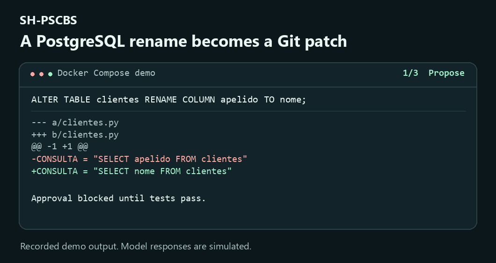

# SH-PSCBS

**Idiomas:** [English](README.md) · [Português (Brasil)](README.pt-BR.md) · Español



**Detecta el código que falla cuando cambia el esquema de PostgreSQL.** SH-PSCBS encuentra el código afectado, propone una corrección en una copia aislada y prepara un commit de Git después de las pruebas, la revisión y la aprobación humana.

## Inicio rápido

Usa Git y Docker Compose para clonar la rama con el flujo integrado y ejecutar la demostración.

```sh
git clone --branch feat/validacao-e-revisao https://github.com/iago511/Self-Healing-Polyglot-Schema-Code-Bifurcation-System.git sh-pscbs
cd sh-pscbs
docker compose -f compose.demo.yaml up --build --exit-code-from demo --attach demo
```

La demostración cambia el nombre de una columna de PostgreSQL, muestra el diff SQL generado, ejecuta pytest y comprueba que el commit aprobado llegue a un remoto local de Git desechable. Usa código de ejemplo y respuestas simuladas de los modelos, así que no requiere claves de API ni una instalación de Ollama.

```sh
docker compose -f compose.demo.yaml down
```

## Supervisa tu proyecto

Copia `.env.example` a `.env`. Configura `PROJECT_PATH`, `DB_URL` y `GROQ_API_KEY`, inicia Ollama y selecciona una imagen Docker de pruebas que incluya pytest y las dependencias de tu proyecto.

```sh
python -m pip install -r requirements.txt
ollama pull qwen2.5-coder:3b
python main.py monitor --uma-vez
```

La primera ejecución guarda una referencia inicial. Ejecuta `python main.py monitor` para seguir observando los cambios. Los eventos y las decisiones se guardan en SQLite. Actualmente, el ejecutor de validación usa pytest.

Consulta la [guía de uso](docs/usage.md) para obtener información sobre Docker, revisión y publicación, y la [descripción de la arquitectura](docs/architecture.md) para conocer el flujo completo.
