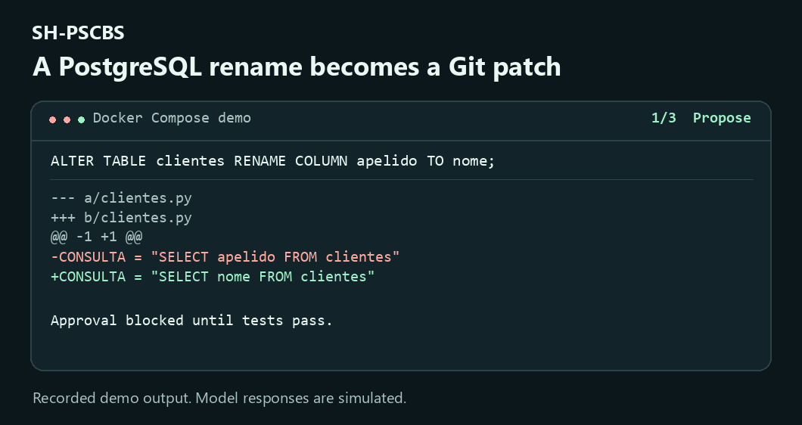

# SH-PSCBS

**Languages:** English · [Português (Brasil)](README.pt-BR.md) · [Español](README.es.md)



**Catch code that breaks when your PostgreSQL schema changes.** SH-PSCBS finds affected code, proposes a fix in an isolated copy, and prepares a Git commit after tests, review, and human approval.

## Quick start

You need Git and Docker Compose. Clone the repository and run the demo:

```sh
git clone https://github.com/iago511/Self-Healing-Polyglot-Schema-Code-Bifurcation-System.git sh-pscbs
cd sh-pscbs
docker compose -f compose.demo.yaml up --build --exit-code-from demo --attach demo
```

The demo renames a PostgreSQL column, prints the generated SQL diff, runs pytest, and checks that the approved commit reaches a disposable local Git remote. It uses sample code and simulated model responses, so you can run it without API keys or an Ollama installation.

```sh
docker compose -f compose.demo.yaml down
```

## What happens after a schema change?

1. The monitor compares PostgreSQL schema snapshots and records an event in SQLite.
2. Schema and impact analysis identify affected code; the planner proposes a correction.
3. The correction agent edits an isolated copy. The executor checks syntax and runs pytest in Docker.
4. A reviewer examines the proposal. Passing tests and a favorable review allow human approval.
5. Approval creates a commit on a separate branch. Publishing requires an explicit command.

## Monitor your own project

Copy `.env.example` to `.env`. Set `PROJECT_PATH`, `DB_URL`, and `GROQ_API_KEY`, start Ollama, and select a Docker test image that contains pytest and your project's dependencies.

```sh
python -m pip install -r requirements.txt
ollama pull qwen2.5-coder:3b
python main.py monitor --uma-vez
```

The first run records a baseline. Run `python main.py monitor` to keep watching for changes. Events and decisions are stored in SQLite. The current validation runner uses pytest.

See the [usage guide](docs/usage.md) for Docker deployment, review, and publishing, and the [architecture overview](docs/architecture.md) for the full workflow.

## VS Code extension

SH-PSCBS also includes a VS Code extension interface for monitoring, reviewing proposal diffs, and approving or rejecting changes. See the [extension setup guide](docs/vscode-extension.md).

## Current scope and limitations

This is an experimental developer tool focused on PostgreSQL and Python projects. The CLI currently uses Portuguese command names. Other languages require further validation and tooling.

Schema polling can miss a change reverted between polls. Column renames are inferred and may need clarification. Generated fixes depend on your project's tests and require review. Groq receives relevant context and code excerpts for planning and review; code generation runs through Ollama. The demo simulates model responses and does not measure live-model reliability.

## Contribute

Try the demo, report a reproducible problem, or improve the documentation. Read [CONTRIBUTING.md](CONTRIBUTING.md) for setup and pull request guidance. Small contributions are welcome.

If this project helps you, consider starring it and sharing a concrete use case. Feedback about schema changes that broke real applications is especially useful.

## License

[MIT](LICENSE).
