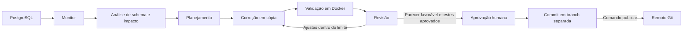

# SH-PSCBS

O SH-PSCBS monitora um schema PostgreSQL, identifica referências no código e prepara propostas de correção em uma cópia do projeto. O monitor grava o progresso no SQLite e pode retomar eventos pendentes após reiniciar.

O planejamento e a revisão usam Groq. A geração de código usa Ollama. A validação funcional executa pytest em uma imagem com as dependências do projeto monitorado. Sem uma imagem funcional ou testes coletados, o evento fica pendente.

Consulte o [guia de execução local e Docker](docs/TUTORIAL_USO_LEIA.MD) e a [arquitetura](docs/ARQUITETURA_MULTIAGENTE.md).
