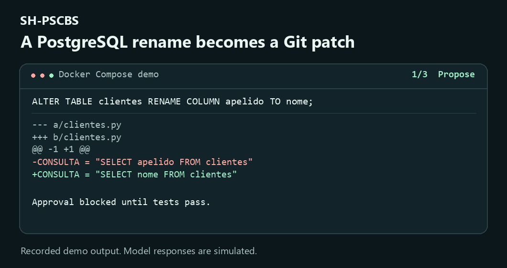

# SH-PSCBS

**Idiomas:** [English](README.md) · Português (Brasil) · [Español](README.es.md)



**Encontre código que quebra quando o schema do PostgreSQL muda.** O SH-PSCBS localiza o código afetado, propõe uma correção em uma cópia isolada e prepara um commit Git após testes, revisão e aprovação humana.

## Início rápido

Use Git e Docker Compose para clonar a branch com o fluxo integrado e executar a demonstração.

```sh
git clone --branch feat/validacao-e-revisao https://github.com/iago511/Self-Healing-Polyglot-Schema-Code-Bifurcation-System.git sh-pscbs
cd sh-pscbs
docker compose -f compose.demo.yaml up --build --exit-code-from demo --attach demo
```

A demonstração renomeia uma coluna do PostgreSQL, mostra o diff SQL gerado, executa o pytest e verifica se o commit aprovado chega a um remoto Git local descartável. Ela usa código de exemplo e respostas simuladas dos modelos, então não precisa de chaves de API nem de uma instalação do Ollama.

```sh
docker compose -f compose.demo.yaml down
```

## Monitore seu projeto

Copie `.env.example` para `.env`. Configure `PROJECT_PATH`, `DB_URL` e `GROQ_API_KEY`, inicie o Ollama e escolha uma imagem Docker de testes que contenha pytest e as dependências do seu projeto.

```sh
python -m pip install -r requirements.txt
ollama pull qwen2.5-coder:3b
python main.py monitor --uma-vez
```

A primeira execução registra uma referência inicial. Use `python main.py monitor` para continuar observando mudanças. Eventos e decisões são armazenados no SQLite. Atualmente, o executor de validação usa pytest.

Consulte o [guia de uso](docs/usage.md) para implantação com Docker, revisão e publicação, e a [visão geral da arquitetura](docs/architecture.md) para conhecer o fluxo completo.
