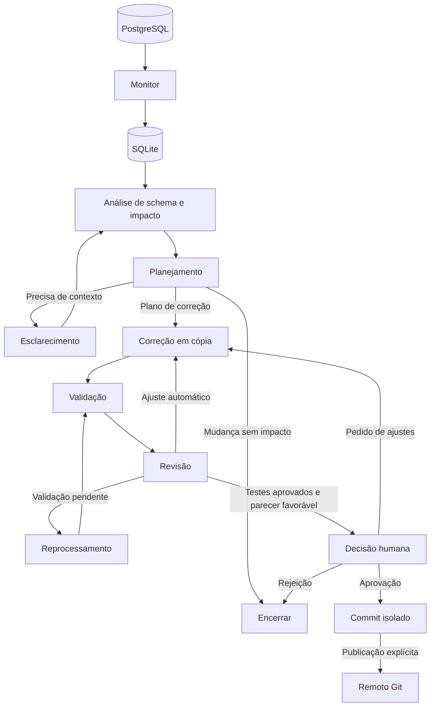

# Arquitetura multiagente do SH-PSCBS

O monitor registra mudanças no schema PostgreSQL e aciona um grafo que leva cada evento até uma proposta testada e revisada. O SQLite persistente guarda snapshots, versões do estado e decisões.

| Componente | Implementação | Responsabilidade |
| --- | --- | --- |
| Observação | `monitoramento/snapshot.py`, `monitoramento/watcher.py` | Lê metadados de tabelas e colunas e registra diferenças entre dois snapshots. |
| Análise | `agentes/schema.py`, `agentes/impacto.py` | Classifica mudanças e reúne evidências de possíveis referências no código. |
| Planejamento | `agentes/planejamento.py` | Usa Groq com ferramentas de leitura para propor ações, concluir que nenhuma alteração é necessária ou pedir esclarecimentos. |
| Correção | `agentes/correcao.py`, `tools/tools_alteracoes.py` | Usa Ollama para gerar alterações na cópia e produz um diff e um manifesto vinculados ao evento. |
| Validação | `validacao/executor.py` | Confere a integridade, verifica sintaxe Python e roda pytest com o projeto completo em Docker. |
| Revisão | `agentes/revisor.py` | Usa Groq para conferir a proposta contra o plano e os resultados de validação. |
| Orquestração | `orquestracao/grafo.py`, `orquestracao/estado.py`, `eventos/repositorio.py` | Encaminha as etapas do LangGraph e persiste os resultados de cada nó. |
| Aprovação e Git | `main.py`, `tools/tools_git.py` | Confere a versão atual do schema, o diff e o checkout. Após aprovação, cria um commit em branch separada e permite publicá-lo por comando. |

## Estado e retomada

O primeiro ciclo grava o schema inicial. Quando o schema muda, o novo snapshot e o evento são gravados na mesma transação. O grafo lê a última etapa persistida e atualiza o registro usando sua versão. Propostas com falhas de teste podem voltar ao agente de correção até o limite definido em `MAX_TENTATIVAS`. A falta de execução do pytest pede intervenção do operador.

Antes da aprovação, o sistema confere novamente a versão do schema, o conteúdo da proposta e a base do projeto. O Git cria o commit com um índice temporário e preserva a branch em uso. A decisão humana e o commit ficam no histórico do evento.

## Escopo atual

A observação funciona por intervalo e detecta estados capturados do PostgreSQL. Uma mudança revertida entre duas consultas pode passar despercebida. Renomeações de colunas são hipóteses geradas pela análise. A validação funcional usa pytest e depende da cobertura da suíte do projeto monitorado. Os contêineres de teste rodam sem rede, com limites de recursos e sem as credenciais do monitor.

A Groq recebe contexto e trechos necessários ao planejamento e à revisão. A geração de código usa Ollama. A cópia exclui arquivos e diretórios conhecidos por conter credenciais, ambientes virtuais, caches e o histórico Git.

## Referências

- [LangGraph e a API de grafos](https://docs.langchain.com/oss/python/langgraph/use-graph-api)
- [PostgreSQL e os metadados de colunas](https://www.postgresql.org/docs/current/infoschema-columns.html)
- [Índice do Git](https://git-scm.com/docs/git-update-index)
