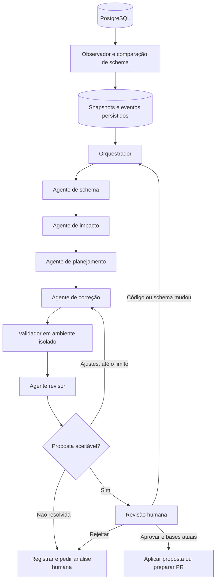

# Arquitetura multiagente para o SH-PSCBS

Este documento descreve uma proposta de evolução. Os componentes e fluxos abaixo ainda precisam ser implementados.

## Objetivo

Transformar uma mudança de schema em uma proposta de correção analisada e verificável. O sistema deve identificar o que mudou, relacionar a mudança ao código, planejar as alterações, gerar uma proposta, executar verificações e apresentar o resultado para revisão.

O primeiro escopo é PostgreSQL e aplicações Python. A expansão para outras linguagens deve ocorrer depois que o fluxo estiver confiável nesse cenário.

## Visão geral



O **observador**, o **armazenamento** e o **validador** são componentes de software com regras explícitas. Os agentes usam modelos de linguagem quando for útil interpretar contexto ou gerar uma proposta. O orquestrador conduz o grafo e aplica as regras de transição; a IA não pode ignorar essas regras.

## Responsabilidades

| Componente | Recebe | Responsabilidade | Entrega |
| --- | --- | --- | --- |
| Observador | Configuração e acesso de leitura ao PostgreSQL | Capturar snapshots, comparar estados e registrar um evento estruturado. | Alterações observadas e identificadores das versões do schema. |
| Orquestrador | Evento persistido | Acionar as etapas, controlar estado, tentativas e limites, e interromper quando faltar informação. | Uma execução rastreável por evento. |
| Agente de schema | Alterações estruturais e snapshots | Explicar a alteração, dependências e possíveis riscos; registrar hipóteses e dúvidas. | Análise do banco, evidências e incertezas. |
| Agente de impacto | Análise do banco e acesso de leitura ao projeto | Identificar consultas, modelos, APIs e testes possivelmente afetados, com arquivo e localização. | Mapa de impacto com evidências. |
| Agente de planejamento | Mudança e mapa de impacto | Propor arquivos a alterar, ordem de trabalho e verificações necessárias. | Plano limitado ao escopo identificado. |
| Agente de correção | Plano, trechos necessários e schema | Gerar alterações em uma cópia isolada do projeto. | Patch e explicação das alterações. |
| Validador | Patch, plano de testes e cópia isolada | Verificar sintaxe e executar testes permitidos em ambiente separado. | Resultados, falhas e limitações das verificações. |
| Agente revisor | Mudança, evidências, patch e resultados | Examinar se a proposta atende ao plano, preserva comportamentos e deixa dúvidas sem resposta. | Aprovação técnica sugerida ou problemas para correção. |
| Pessoa responsável | Relatório completo | Examinar a proposta e decidir se deve ser aplicada. | Aprovação, rejeição ou pedido de revisão. |

O revisor é uma segunda análise, não uma garantia de correção. O orquestrador consolida o relatório; não é necessário criar um agente separado apenas para resumi-lo.

## Fluxo de uma execução

1. **Observar.** O observador compara o schema lido com o último estado observado. Na primeira leitura, registra uma base inicial sem propor alterações.
2. **Registrar.** O evento e o avanço da base observada são gravados juntos em armazenamento transacional próprio do sistema. Uma falha de processamento deixa o evento pendente; ela não deve apagá-lo.
3. **Analisar o banco.** Um diff determinístico informa alterações de tabelas, colunas e propriedades. O agente acrescenta contexto e assinala incertezas. Uma coluna removida e outra adicionada podem indicar renomeação, mas não a comprovam.
4. **Mapear o projeto.** Ferramentas identificam referências e retornam evidências. Em Python, a análise pode combinar AST, inspeção de SQL e busca textual como apoio. A cobertura é parcial em casos dinâmicos e deve ser apresentada como tal.
5. **Planejar.** O agente define alterações e testes por arquivo. Se faltarem regras de negócio, o fluxo para com uma pergunta ou relatório, em vez de inventar um comportamento.
6. **Gerar proposta.** O agente de correção trabalha em uma cópia isolada ou worktree. Não altera o projeto original nem o banco monitorado. A saída é um patch, não uma substituição direta do arquivo original.
7. **Validar e revisar.** Um executor roda as verificações configuradas; o revisor compara o resultado com o plano. Se houver problema corrigível, o orquestrador pode retornar ao agente de correção, respeitando um limite inicial de duas tentativas. Ao atingir o limite, registra a falha e encaminha para análise humana.
8. **Aprovar e aplicar.** A pessoa revisa o diff, os testes e as incertezas. Antes de aplicar, o sistema confirma que o schema e a versão dos arquivos continuam compatíveis com os usados na proposta. Se mudaram, a proposta precisa ser reavaliada.

Essa primeira versão reage a mudanças já observadas no banco. Portanto, ela não impede uma indisponibilidade causada por uma alteração destrutiva já aplicada. Uma evolução posterior pode analisar migrações antes da implantação por meio da CI.

## Contrato entre componentes

As mensagens devem ser objetos estruturados, validados por modelos como os do Pydantic já utilizado no projeto. Um contrato inicial pode conter:

```json
{
  "evento_id": "evt-001",
  "projeto_id": "projeto-exemplo",
  "banco_id": "banco-exemplo",
  "schema": "public",
  "schema_anterior_id": "hash-anterior",
  "schema_atual_id": "hash-atual",
  "codigo_base_id": "hash-do-commit-ou-dos-arquivos",
  "mudancas": [
    {"tipo": "coluna_removida", "tabela": "clientes", "coluna": "email"},
    {"tipo": "coluna_adicionada", "tabela": "clientes", "coluna": "email_contato"}
  ],
  "hipoteses": [
    {"descricao": "Possível renomeação de email para email_contato", "confirmada": false}
  ],
  "evidencias": [],
  "plano": null,
  "patch_id": null,
  "validacoes": [],
  "status": "detectado"
}
```

Os identificadores no exemplo são ilustrativos. O evento contém referência ao banco, nunca sua URL com senha. As evidências devem incluir caminho, linha ou intervalo, tipo de análise e uma descrição verificável. Uma hipótese incerta permanece como hipótese até ser esclarecida.

## Estado e recuperação

Uma máquina de estados inicial pode seguir:

```text
detectado → analisando → planejado → proposta_gerada → validando
    → em_revisao → aguardando_aprovacao → aplicado
```

Estados alternativos: `precisa_esclarecimento`, `falhou` e `rejeitado`. Cada transição registra motivo, horário e tentativa. Uma falha não é marcada como sucesso.

- Usar um identificador próprio por evento como `thread_id`; os IDs fixos atuais por tipo de mudança não devem identificar execuções diferentes.
- Persistir eventos e snapshots em armazenamento interno separado do banco monitorado. Para começar localmente, uma base SQLite transacional é uma opção; outro armazenamento pode ser usado conforme a implantação.
- Configurar um checkpointer durável para o grafo. O `thread_id` sozinho não fornece persistência. Manter o registro do evento independente do estado de execução do agente.
- Retomar ou reprocessar com operações idempotentes e limitar novas tentativas. Não presumir execução exatamente uma vez apenas por usar uma fila ou checkpoints.
- Processar alterações dependentes do mesmo projeto na ordem observada. Em caso de conflito com uma proposta pendente, reavaliar a base antes de aplicar.
- A captura por intervalo observa estados, não todas as operações: uma mudança feita e desfeita entre duas leituras pode passar despercebida. Registrar essa limitação; outra fonte de eventos pode ser avaliada depois.

## Limites e permissões

- Restringir o banco monitorado à leitura de metadados necessários. Validar se a conta tem visibilidade suficiente; a visualização `information_schema.columns` só apresenta colunas acessíveis à conta utilizada.
- Cada agente recebe apenas as ferramentas necessárias. Os agentes de análise não recebem ferramentas genéricas para excluir ou alterar arquivos.
- O agente de correção escreve somente na cópia isolada e dentro dos caminhos aprovados para a execução. A aplicação no projeto original é uma etapa separada.
- Executar testes com tempo e recursos limitados, sem credenciais de produção e sem acesso de rede por padrão; quando for necessário banco, usar uma instância de teste descartável. Configurar o isolamento de acordo com o ambiente de implantação.
- Tratar arquivos e comentários do projeto como dados, não como instruções que possam ampliar permissões. Reduzir e filtrar o contexto enviado a modelos externos para evitar envio de segredos.
- Se o teste necessário não existir, falhar ou não puder ser executado, exibir isso no relatório. A falta de teste não deve aparecer como validação concluída.

## Relação com o código atual

| Código atual | Evolução proposta |
| --- | --- |
| `sh_pscbs/monitoramento/snapshot.py` | Manter a leitura do PostgreSQL e evoluir para snapshots e diffs estruturados, incluindo propriedades e relacionamentos. |
| `sh_pscbs/monitoramento/watcher.py` | Registrar eventos em vez de montar mensagens longas diretamente para o agente. |
| `main.py` | Separar inicialização, execução interativa e monitoramento; inicializar o grafo com persistência configurada. |
| `tools/tools.py` | Reaproveitar operações de leitura e busca; substituir a reescrita direta por geração de patch em cópia isolada e limitar ferramentas por agente. |
| `sh_pscbs/agentes/prompts.py` | Dividir instruções por responsabilidade e exigir saídas estruturadas, evidências e indicação de incerteza. |
| `testes/` | Acrescentar testes de eventos, recuperação, análise de impacto e validação do fluxo com banco de teste. |

As pastas `agentes/`, `orquestracao/`, `eventos/` e `validacao/` dentro de `sh_pscbs/` já têm arquivos vazios reservados para implementar os papéis, o grafo, a persistência e a validação.

## Modelos e tecnologia

O agente atual usa GPT-OSS 120B via Groq, com GPT-OSS 20B como reserva para falhas transitórias. As ferramentas que propõem alterações de código usam Qwen via Ollama. A escolha dos modelos para cada agente futuro pode ser avaliada com casos reais e contratos estruturados.

LangGraph é uma opção coerente com a stack atual para implementar o grafo, a persistência por execução e a pausa para revisão. Se for adotado diretamente, declarar sua dependência explicitamente e configurar um checkpointer durável.

## Sequência de implementação

1. **Fundação:** configuração, diff estruturado, armazenamento transacional de eventos e testes de recuperação.
2. **Somente análise:** agentes de schema e impacto geram relatório com evidências, sem alterar arquivos.
3. **Proposta:** planejamento e geração de patch em cópia isolada.
4. **Validação e revisão:** testes controlados, revisor, limite de tentativas e aprovação humana.
5. **Integração:** aplicação controlada ou proposta de PR, histórico e métricas; depois, suporte a outras linguagens e análise antes de migrações.

O marco inicial está concluído quando uma mudança detectada é registrada, sobrevive a uma reinicialização e pode gerar um relatório de impacto sem modificar o projeto monitorado.

## Referências

- [LangGraph: padrões de workflows e agentes](https://docs.langchain.com/oss/python/langgraph/workflows-agents)
- [LangGraph: persistência](https://docs.langchain.com/oss/python/langgraph/persistence)
- [LangGraph: interrupções para revisão humana](https://docs.langchain.com/oss/python/langgraph/interrupts)
- [PostgreSQL: metadados de colunas](https://www.postgresql.org/docs/current/infoschema-columns.html)
