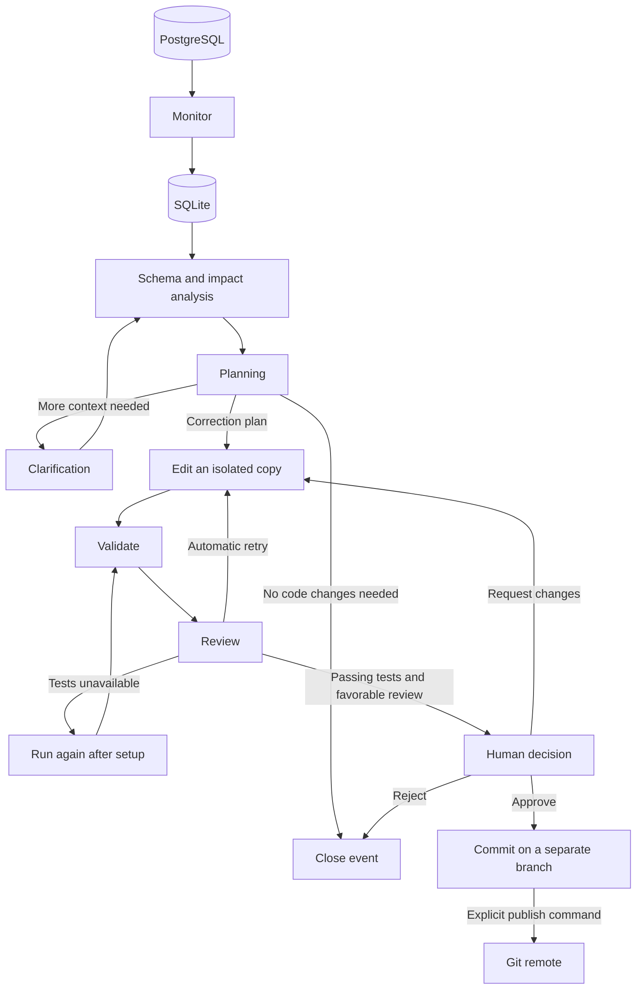

# Workflow architecture

The PostgreSQL monitor starts a LangGraph workflow for each detected schema change. SQLite stores snapshots, event state, and human decisions so each event can resume from its last recorded stage.

| Component | Role |
| --- | --- |
| PostgreSQL monitor | Reads table and column metadata and records differences between snapshots. |
| Schema and impact analysis | Classifies changes and finds evidence in the project's files. |
| Planner | Uses Groq and read-only tools to plan a correction or request clarification. |
| Correction agent | Uses Ollama to edit an isolated copy and generate a diff and manifest. |
| Executor | Checks integrity and Python syntax, then runs pytest in an isolated Docker container. |
| Reviewer | Uses Groq to compare the diff with the plan and the validation results. |
| Human approval and Git | Checks the schema, diff, and checkout again before creating a commit on a separate branch. |

The monitor saves the new snapshot and its event in one transaction. The graph can retry repairs up to `MAX_TENTATIVAS`. A missing or incomplete test run leaves the event open for the operator.

The monitor observes schema states at intervals, so a change that is reverted between polls can go undetected. The analyzer treats a dropped column followed by a new column as a possible rename. Test coverage comes from the monitored project.

Groq receives relevant context and code excerpts for planning and review. Code generation runs through Ollama. Test containers are isolated from the network and do not inherit the monitor's credentials.
